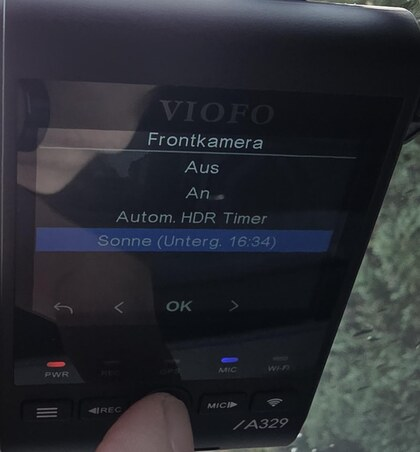

# NECKTIED – Erweiterungen für VIOFO-Dashcams

*[English version](README.md)*

> Inoffiziell, nicht mit VIOFO verbunden. Nutzung auf eigenes Risiko.

> [!WARNING]
> **Das Flashen veränderter Firmware birgt immer das Risiko, die Kamera unbrauchbar zu machen („Bricken“),**
> egal wie sorgfältig NECKTIED gebaut und geprüft ist. **Durch veränderte Firmware können Garantie- und
> Gewährleistungsansprüche gegenüber VIOFO erlöschen.** Nutze NECKTIED nur, wenn du beides in Kauf nimmst.
> Der SD-Modus verändert die Firmware nicht und ist der sicherere Weg, NECKTIED zuerst auszuprobieren.

NECKTIED ergänzt die Original-Firmware einiger VIOFO-Dashcams um:

- **Zeitzone automatisch** aus der GPS-Position (A329- und A229-Familie, VS1, A119 Mini / Mini 2)
- **Sommerzeit nach echter Regel** der erkannten Zone statt pauschal +1 h
  (Europa, USA/Kanada, Australien, Neuseeland, Chile)
- **HDR nach Sonnenauf- und -untergang** („Sonne“), mit einstellbarem Puffer
- Versionskennung `-NECKTIED` und bei Kameras mit Display geänderte Ein- und
  Ausschaltbilder – ein schneller Hinweis beim Start, dass nicht die Original-Firmware läuft

Dieses Repository enthält **keine Viofo-Firmware**. Du lädst das Original-Update deiner Kamera selbst bei VIOFO herunter; der Patcher baut daraus auf deinem Rechner die NECKTIED-Firmware. Die Datei verlässt dabei deinen Rechner nicht.

## Funktionen je Kamera

| Funktion | A329-Familie | A229-Familie | VS1 | A119 Mini / Mini 2 | A119 V3 ¹ | A129 Plus Duo ¹ ⁴ | A129 Pro Duo ¹ ⁴ | A139 Pro / 2CH/3CH ¹ ⁴ | T130 ¹ ⁴ | WM1 ¹ ⁴ |
|---|---|---|---|---|---|---|---|---|---|---|
| Zeitzone aus der GPS-Position | ⚙️ | ⚙️ | ⚙️ | ⚙️ | — | — | — | — | — | — |
| Sommerzeit nach Regel | ⚙️ | ⚙️ | 🔒 | 🔒 | 🔒 | 🔒 | 🔒 | 🔒 | 🔒 | 🔒 |
| HDR-Zeitsteuerung (an/aus nach Uhrzeit) | ✔️ | ✔️ | ⚙️ ² | ✔️ | ✔️ | ✔️ | — | ✔️ | — | — |
| Sonnen-HDR (nach Auf-/Untergang) | ⚙️ | ⚙️ | ⚙️ | ⚙️ | ⚙️ | ⚙️ | — | ⚙️ | — | — |
| Versionskennung `-NECKTIED` | 🔒 | 🔒 | 🔒 | 🔒 | 🔒 | 🔒 | 🔒 | 🔒 | 🔒 | 🔒 |
| Geändertes Ein-/Ausschaltbild | 🔒 | 🔒 | — | 🔒 ³ | 🔒 | 🔒 | 🔒 | — | — | — |

⚙️ per Einstellung bzw. gepatchter Menüoption · 🔒 immer aktiv (vom Patch vorgegeben) · ✔️ bereits in der Original-Firmware · — nicht verfügbar

¹ Diese Kameras erkennen keine Zeitzone; ihre Sommerzeit richtet sich nach dem eingestellten Versatz (nur Europa, USA/Kanada).

² Im Original nur per App; NECKTIED ergänzt es im Kameramenü.

³ Nur Einschaltbild.

⁴ Geplant, noch nicht im öffentlichen Patcher.

**So wird es eingeschaltet**

- **Zeitzone aus der GPS-Position:** Einstellung „GPS-Zeitabgleich“ an. Die Kamera stellt dann ihre Zeitzone nach der Position, unabhängig von der Einstellung „Sommerzeit“ (A329-/A229-Familie: ist sie aus, bleibt die Kamera das ganze Jahr auf Normalzeit); wer die Zone von Hand ändert, pausiert die Automatik bis zum nächsten Start.
- **Sommerzeit nach Regel:** A329-/A229-Familie: Einstellung „Sommerzeit“ an – NECKTIED wendet die echte Regel der Zone an statt pauschal +1 h. Alle anderen Kameras haben keine solche Einstellung, dort gilt die Regel immer. **Normalzeit-Zone einstellen** (Deutschland: UTC+1, Sydney: UTC+10 – auch im Sommer).
  - Bekannte Regeln: Europa, USA/Kanada, Australien (NSW, Victoria, Tasmanien, South Australia, ACT, Norfolkinsel), Neuseeland, Chile. Zonen ohne Sommerzeit (z. B. Queensland, Brasilien, Argentinien, Südafrika, große Teile Asiens und Afrikas) bleiben richtigerweise auf Normalzeit.
  - Nicht unterstützt: Zonen mit anderen Regeln (z. B. Israel, Ägypten, Libanon, Kuba; Lord-Howe-Insel mit ihrer halben Stunde) bekommen keine Sommerzeit.
  - Ohne per GPS erkannte Zone (GPS-Zeitabgleich aus, Zone von Hand geändert, vor dem ersten Fix) gilt weiter die zuletzt erkannte Zone; ist die Kamera auf eine andere Zone gestellt, ergibt sich die Regel aus dem Versatz: Europa für UTC+0 bis +2, USA für UTC−4 bis −9, sonst keine.
- **HDR-Zeitsteuerung:** VS1: neue Optionen „Auto“ und „Sonne“ im HDR-Menü der Kamera.
- **Sonnen-HDR:** A329- und A229-Familie, VS1, A119 Mini / Mini 2: im HDR-Menü die neue Option **„Sonne“** wählen; HDR schaltet dann vor Sonnenuntergang ein und nach Sonnenaufgang aus (Puffer standardmäßig 30 min, über die HDR-Timer-Zeiten einstellbar). A119 V3, A129 Plus Duo, A139-Reihe: HDR-Timer auf Aus **00:MM** und An **12:NN** stellen – MM/NN sind die Minuten Puffer nach Aufgang bzw. vor Untergang.
- **Versionskennung und Bilder:** immer aktiv; sie zeigen beim Start, dass NECKTIED läuft.

### So findet „Sonne“-HDR Sonnenauf- und -untergang

- **Wo:** Die Kamera merkt sich ihre letzte GPS-Position (einmal am Tag aktualisiert, oder sofort,
  wenn sie mehr als etwa 200 km weiter ist). Eine Internetverbindung braucht sie nicht.
- **Wann:** Aus Datum und Position berechnet die Kamera Sonnenauf- und -untergang selbst, mit der
  üblichen astronomischen Formel, die auch Wetterdienste verwenden (NOAA). Sie ist auf etwa eine
  Minute genau. Wie üblich gilt: Sonnenaufgang ist, wenn der obere Sonnenrand am flachen Horizont
  erscheint – Berge oder Häuser werden nicht berücksichtigt.
- **HDR-Zeitfenster:** HDR schaltet *vor Sonnenuntergang* ein und *nach Sonnenaufgang* aus, jeweils
  um den Puffer versetzt (Standard 30 Minuten; die HDR-Timer-Zeiten legen den Puffer fest, z. B.
  00:45 = 45 Minuten, höchstens 3 Stunden). Die Zeiten werden jeden Tag neu berechnet und folgen so
  von selbst den Jahreszeiten.
- **Im Menü** zeigt die Option das nächste Ereignis, z. B. „Sonne (Unterg. 16:34)“.
- **Sonderfälle:** noch keine GPS-Position – HDR von 17:00 bis 07:00, im Menü steht „Sonne (ohne GPS)“.
  Mitternachtssonne – HDR bleibt aus; Polarnacht – HDR bleibt an.

*A329: Video-Einstellungen → HDR → Frontkamera → Sonne. Die Option zeigt den heutigen Sonnenuntergang.*

## So geht’s

Patchen im Browser: **<https://necktiedhummingbird.github.io/Viofo-Necktied/>**. Alles Weitere liegt auf der **[Release-Seite](../../releases/latest)**:

| Datei | Wofür |
|---|---|
| `NECKTIED_SD_A.zip` | SD-Modus für die A329-Familie (A329S, A329T, A329TC, A329WW, A329) |
| `NECKTIED_SD_B.zip` | SD-Modus für die A229-Familie und die VS1 |
| `necktied-package.zip` | eigene Dateien von NECKTIED für den Patcher (keine VIOFO-Firmware darin) |
| `SHA256SUMS.txt` | Prüfsummen, falls du die Downloads prüfen willst |

Auf deiner Kamera muss **genau die Firmware-Version laufen, die unter [Unterstützte Kameras](#unterstützte-kameras) steht**.
Falls nicht, zuerst diese Original-Version von VIOFO aufspielen: <https://www.viofo.com/pages/firmware>.

### Schritt 1: ohne Flashen ausprobieren (SD-Modus) – empfohlen

Für A329-Familie, A229-Familie und VS1. Die Firmware wird nicht verändert.

1. `NECKTIED_SD_A.zip` bzw. `NECKTIED_SD_B.zip` für deine Kamera laden und entpacken.
2. **Alle** Dateien ins **Wurzelverzeichnis** der Speicherkarte kopieren (nicht in einen Ordner). Videos auf der Karte bleiben erhalten.
3. Karte sauber auswerfen, in die Kamera stecken, Kamera einschalten.
4. Kontrolle: Die Version im Kameramenü endet auf `-NECKTIED`, und die Datei `NECKTIED_SD_STATUS.txt`
   auf der Karte meldet, dass NECKTIED aktiv ist.

Beenden: die NECKTIED-Dateien von der Karte löschen (oder die Karte in der Kamera formatieren) – die
Kamera ist wieder original. Im Paket liegt eine `LIESMICH.txt` mit allen Einzelheiten.

### Schritt 2: dauerhaft installieren (flashen)

1. Original-Firmware für deine Kamera bei VIOFO laden: <https://www.viofo.com/pages/firmware>.
2. Den **[NECKTIED-Patcher](https://necktiedhummingbird.github.io/Viofo-Necktied/)** im Browser öffnen und die Firmware-Datei hineinziehen.
   Er erkennt die Kamera, baut die NECKTIED-Firmware auf deinem Rechner und bietet die Datei zum Speichern an.
   - Für Erfahrene gibt es auch eine Kommandozeilen-Version (Python 3, ohne Optionen): beim Release
     „Source code (zip)“ laden und entpacken, `necktied-package.zip` aus demselben Release in dessen
     Ordner `patcher/` legen und `python3 patcher/necktied_patch.py FWA329S.bin` ausführen – darüber
     hinaus ohne Hilfestellung.
3. Die Speicherkarte in der Kamera formatieren, dann die NECKTIED-Firmware ins Wurzelverzeichnis der Karte
   kopieren. Den Dateinamen vom Patcher beibehalten (z. B. `FWA329S.bin`), keine andere Firmware-Datei auf die Karte legen.
4. Karte sauber auswerfen, in die Kamera stecken, Kamera einschalten. Die Kamera aktualisiert sich selbst –
   **während des Updates nicht vom Strom trennen**. Danach ist die Datei von der Karte verschwunden.
   - A119 V3: Nach dem Update prüfen, ob die Version auf `-NECKTIED` endet; liegt die Datei noch auf der Karte,
     sie löschen, damit die Kamera beim nächsten Start nicht erneut aktualisiert.

**Rückweg:** die Original-Firmware von VIOFO genauso aufspielen (Punkte 3–4 von Schritt 2).

## Unterstützte Kameras

| Kamera | Firmware | Weg | Status |
|---|---|---|---|
| **A329-Familie** | | | |
| A329S | V2.2_260815 | Patcher oder SD-Modus | am Gerät geprüft |
| A329T | V2.2_260815 | Patcher oder SD-Modus | experimentell |
| A329TC | V2.2_260815 | Patcher oder SD-Modus | experimentell |
| A329WW | V2.2_260815 | Patcher oder SD-Modus | experimentell |
| A329 | V2.0_260812 | Patcher oder SD-Modus | experimentell |
| **A229-Familie** | | | |
| A229 Plus | V1.5_260813 | Patcher oder SD-Modus | experimentell |
| A229 Pro | V1.5_260813 | Patcher oder SD-Modus | experimentell |
| A229 Pro Tele | V1.5_260813 | Patcher oder SD-Modus | experimentell |
| A229 Ultra | V1.2_260813 | Patcher oder SD-Modus | experimentell |
| **VS1** | | | |
| VS1 | V1.1_260812 | Patcher oder SD-Modus | experimentell |
| **A119-Familie** | | | |
| A119 Mini | V1.2 (2026-08-26) | Patcher | experimentell |
| A119 Mini 2 | V3.2 (2026-08-26) | Patcher | experimentell |
| A119 V3 | V2.6 (2024-10-31) | Patcher | experimentell |
| **Weitere Kameras (geplant)** | | | |
| A129 Plus Duo | V2.0 (2024-10-16) | geplant | geplant |
| A129 Pro Duo | V2.91 (2024-09-13) | geplant | geplant |
| A139 Pro | V1.2_240710 | geplant | geplant |
| A139 2CH/3CH | V1.9_240710 | geplant | geplant |
| T130 | V1.2_0505 | geplant | geplant |
| WM1 | V1.1_0602 | geplant | geplant |

Ergebnisse je Funktion, Labortests und Gerätemeldungen: **[TESTED.md](TESTED.md)** (englisch). Änderungen je Version: **[CHANGELOG.md](CHANGELOG.md)** (englisch).

„Experimentell“ heißt: Die Erweiterung ist mit Emulation und automatischen Prüfungen getestet, lief aber noch auf keinem Gerät dieses Modells.

## Lizenz

Code: MIT (siehe `LICENSE`).

Zeitzonen-Daten: abgeleitet aus [timezone-boundary-builder](https://github.com/evansiroky/timezone-boundary-builder),
© [OpenStreetMap](https://www.openstreetmap.org/copyright)-Mitwirkende, lizenziert unter der
[Open Database License (ODbL) 1.0](https://opendatacommons.org/licenses/odbl/1-0/) – Details in `NOTICE.de.md`.
