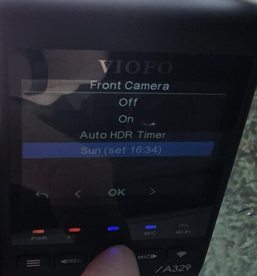

# NECKTIED – extensions for VIOFO dash cams

*[Deutsche Fassung](README.de.md)*

> Unofficial, not affiliated with VIOFO. Use at your own risk.

> [!WARNING]
> **Flashing modified firmware always carries a risk of making the camera unusable ("bricking"),**
> no matter how carefully NECKTIED is built and tested. **Installing modified firmware may void your
> warranty and any claims against VIOFO.** Use NECKTIED only if you accept both. The SD mode does not
> change the firmware and is the safer way to try NECKTIED first.

NECKTIED adds the following to the original firmware of several VIOFO dash cams:

- **Automatic time zone** from the GPS position (A329 and A229 family, VS1, A119 Mini / Mini 2)
- **Daylight saving time by the real rule** of the detected zone instead of a flat +1 h
  (Europe, USA/Canada, Australia, New Zealand, Chile)
- **HDR by sunrise and sunset** ("Sun" mode) with an adjustable margin
- a version tag `-NECKTIED` and, on cameras with a display, different power-on and
  power-off images – a quick sign at start-up that the camera is not running the
  original firmware

This repository contains **no VIOFO firmware**. You download the original update for your camera from VIOFO yourself; the patcher builds the NECKTIED firmware from it on your own computer. The file never leaves your computer.

## Features per camera

| Feature | A329 family | A229 family | VS1 | A119 Mini / Mini 2 | A119 V3 ¹ | A129 Plus Duo ¹ ⁴ | A129 Pro Duo ¹ ⁴ | A139 Pro / 2CH/3CH ¹ ⁴ | T130 ¹ ⁴ | WM1 ¹ ⁴ |
|---|---|---|---|---|---|---|---|---|---|---|
| Time zone from GPS position | ⚙️ | ⚙️ | ⚙️ | ⚙️ | — | — | — | — | — | — |
| Daylight saving time by rule | ⚙️ | ⚙️ | 🔒 | 🔒 | 🔒 | 🔒 | 🔒 | 🔒 | 🔒 | 🔒 |
| HDR timer (on/off by time) | ✔️ | ✔️ | ⚙️ ² | ✔️ | ✔️ | ✔️ | — | ✔️ | — | — |
| Sun HDR (by sunrise/sunset) | ⚙️ | ⚙️ | ⚙️ | ⚙️ | ⚙️ | ⚙️ | — | ⚙️ | — | — |
| Version tag `-NECKTIED` | 🔒 | 🔒 | 🔒 | 🔒 | 🔒 | 🔒 | 🔒 | 🔒 | 🔒 | 🔒 |
| Different power-on/-off image | 🔒 | 🔒 | — | 🔒 ³ | 🔒 | 🔒 | 🔒 | — | — | — |

⚙️ enabled by a setting or a patched menu option · 🔒 always on (set by the patch) · ✔️ already in the original firmware · — not available

¹ These cameras cannot detect the time zone; their daylight saving time follows the set offset (Europe, USA/Canada only).

² The original offers it only in the app; NECKTIED adds it to the camera menu.

³ Power-on image only.

⁴ Planned, not yet in the public patcher.

**How to enable**

- **Time zone from GPS position:** camera setting "GPS time sync" on. The camera then sets its time zone from the position, independent of the "Daylight saving time" setting (A329/A229 family: with it off, the camera keeps standard time all year); changing the zone by hand pauses the automation until the next start.
- **Daylight saving time by rule:** A329/A229 family: setting "Daylight saving time" on – NECKTIED applies the real rule of the zone instead of a flat +1 h. All other cameras have no such setting, so the rule is always active. **Set the standard-time zone** (e.g. Germany: UTC+1, Sydney: UTC+10 – also in summer).
  - Known rules: Europe, USA/Canada, Australia (NSW, Victoria, Tasmania, South Australia, ACT, Norfolk Island), New Zealand, Chile. Zones without daylight saving time (e.g. Queensland, Brazil, Argentina, South Africa, most of Asia and Africa) stay on standard time, as they should.
  - Not supported: zones with other rules (e.g. Israel, Egypt, Lebanon, Cuba; Lord Howe Island with its 30-minute shift) get no daylight saving time.
  - Without a GPS-detected zone (GPS time sync off, zone changed by hand, before the first fix) the camera keeps using the zone it detected last; if it is set to another zone, the rule is derived from the offset: Europe for UTC+0 to +2, USA for UTC−4 to −9, none otherwise.
- **HDR timer:** VS1: new options "Auto" and "Sun" in the HDR menu of the camera.
- **Sun HDR:** A329 and A229 family, VS1, A119 Mini / Mini 2: choose the new option **"Sun"** in the HDR menu; HDR then switches on before sunset and off after sunrise (default margin 30 min, adjustable via the HDR timer times). A119 V3, A129 Plus Duo, A139 line: set the HDR timer to off **00:MM** and on **12:NN** – MM/NN are the minutes of margin after sunrise/before sunset.
- **Version tag and images:** always active; at start-up they show that NECKTIED is running.

### How "Sun" HDR finds sunrise and sunset

- **Where:** the camera remembers its last GPS position (updated once a day, or right away after
  driving more than about 200 km). No internet connection is needed.
- **When:** from the date and this position the camera calculates sunrise and sunset itself, with
  the standard astronomical formula also used by weather services (NOAA). It is accurate to about
  a minute. As usual, "sunrise" is the moment the top edge of the sun appears on a flat horizon –
  hills or buildings are not taken into account.
- **HDR window:** HDR switches on *before sunset* and off *after sunrise*, each by the margin
  (default 30 minutes; the HDR timer times set the margin, e.g. 00:45 = 45 minutes, at most 3 hours).
  The times are recalculated every day, so they follow the seasons by themselves.
- **In the menu** the option shows the next event, e.g. "Sun (set 16:34)".
- **Special cases:** no GPS position yet – HDR from 17:00 to 07:00, the menu shows "Sun (no GPS)".
  Midnight sun – HDR stays off; polar night – HDR stays on.

*A329: Video Settings → HDR → Front Camera → Sun. The option shows today's sunset.*

## How to use

Patch in the browser: **<https://necktiedhummingbird.github.io/Viofo-Necktied/>**. Everything else is on the **[Releases page](../../releases/latest)**:

| File | What it is for |
|---|---|
| `NECKTIED_SD_A.zip` | SD mode for the A329 family (A329S, A329T, A329TC, A329WW, A329) |
| `NECKTIED_SD_B.zip` | SD mode for the A229 family and the VS1 |
| `necktied-package.zip` | NECKTIED's own files for the patcher (no VIOFO firmware inside) |
| `SHA256SUMS.txt` | checksums, if you want to verify the downloads |

Your camera must run **exactly the firmware version listed under [Supported cameras](#supported-cameras)**.
If not, first install that original version from VIOFO: <https://www.viofo.com/pages/firmware>.

### Step 1: try it without flashing (SD mode) – recommended

For the A329 family, the A229 family and the VS1. The firmware is not changed.

1. Download `NECKTIED_SD_A.zip` or `NECKTIED_SD_B.zip` for your camera and unzip it.
2. Copy **all** files to the **root directory** of the memory card (not into a folder). Videos on the card stay.
3. Eject the card safely, put it into the camera, switch the camera on.
4. Check: the version in the camera menu ends with `-NECKTIED`, and the file `NECKTIED_SD_STATUS.txt`
   on the card says NECKTIED is active.

To stop: delete the NECKTIED files from the card (or format the card in the camera) – the camera is
original again. The package contains a `README.txt` with all details.

### Step 2: install it permanently (flash)

1. Download the original firmware for your camera from VIOFO: <https://www.viofo.com/pages/firmware>.
2. Open the **[NECKTIED patcher](https://necktiedhummingbird.github.io/Viofo-Necktied/)** in your browser and drop the firmware file onto it.
   It recognises the camera, builds the NECKTIED firmware on your computer and gives you the file to save.
   - For experienced users there is also a command line version (Python 3, no options): download
     the release's "Source code (zip)" and unzip it, put `necktied-package.zip` from the same release
     into its `patcher/` folder and run `python3 patcher/necktied_patch.py FWA329S.bin` – no support
     beyond this line.
3. Format the memory card in the camera, then copy the NECKTIED firmware file to the root directory of the
   card. Keep the file name the patcher gives you (e.g. `FWA329S.bin`) and put no other firmware file on the card.
4. Eject the card safely, put it into the camera, switch the camera on. The camera updates itself – **do not
   cut the power during the update**. Afterwards the file is gone from the card.
   - A119 V3: after the update, check that the version ends in `-NECKTIED`; if the file is still on the card,
     delete it so the camera does not update again at the next start.

**Going back:** install the original firmware from VIOFO the same way (steps 3–4 of step 2).

## Supported cameras

| Camera | Firmware | How | Status |
|---|---|---|---|
| **A329 family** | | | |
| A329S | V2.2_260815 | patcher or SD mode | tested on a device |
| A329T | V2.2_260815 | patcher or SD mode | experimental |
| A329TC | V2.2_260815 | patcher or SD mode | experimental |
| A329WW | V2.2_260815 | patcher or SD mode | experimental |
| A329 | V2.0_260812 | patcher or SD mode | experimental |
| **A229 family** | | | |
| A229 Plus | V1.5_260813 | patcher or SD mode | experimental |
| A229 Pro | V1.5_260813 | patcher or SD mode | experimental |
| A229 Pro Tele | V1.5_260813 | patcher or SD mode | experimental |
| A229 Ultra | V1.2_260813 | patcher or SD mode | experimental |
| **VS1** | | | |
| VS1 | V1.1_260812 | patcher or SD mode | experimental |
| **A119 family** | | | |
| A119 Mini | V1.2 (2026-08-26) | patcher | experimental |
| A119 Mini 2 | V3.2 (2026-08-26) | patcher | experimental |
| A119 V3 | V2.6 (2024-10-31) | patcher | experimental |
| **More cameras (planned)** | | | |
| A129 Plus Duo | V2.0 (2024-10-16) | planned | planned |
| A129 Pro Duo | V2.91 (2024-09-13) | planned | planned |
| A139 Pro | V1.2_240710 | planned | planned |
| A139 2CH/3CH | V1.9_240710 | planned | planned |
| T130 | V1.2_0505 | planned | planned |
| WM1 | V1.1_0602 | planned | planned |

Per-feature results, lab tests and device reports: **[TESTED.md](TESTED.md)**. What changed in each version: **[CHANGELOG.md](CHANGELOG.md)**.

"Experimental" means: the extension has passed emulation and automated checks but has not yet run on a device of that model.

## License

Code: MIT (see `LICENSE`).

Time zone data: derived from [timezone-boundary-builder](https://github.com/evansiroky/timezone-boundary-builder),
© [OpenStreetMap](https://www.openstreetmap.org/copyright) contributors, licensed under the
[Open Database License (ODbL) 1.0](https://opendatacommons.org/licenses/odbl/1-0/) – details in `NOTICE.md`.
